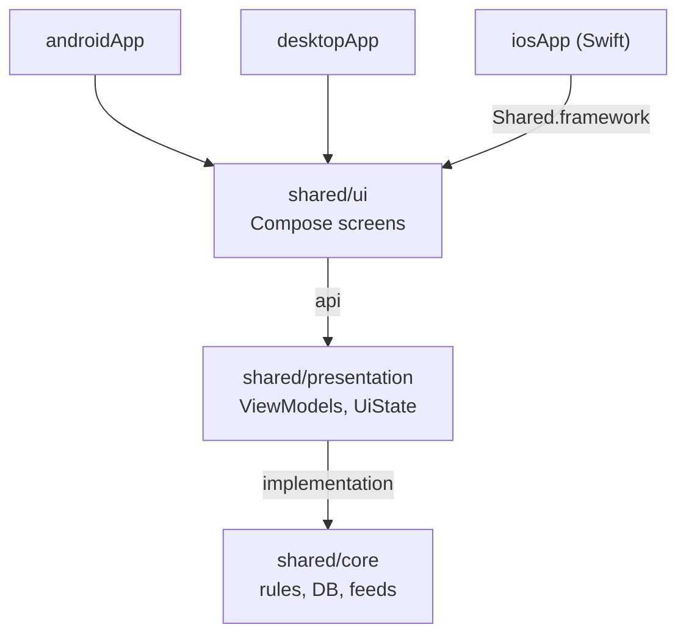

# Architecture

Damask is a Kotlin Multiplatform app. All logic is shared; each platform app supplies only its shell (and, later, audio playback).

## Modules

| Module | Contains | May not depend on |
|---|---|---|
| `shared/core` | Domain model, rotation rules, SQLDelight database, feed fetching and parsing, import | Compose, AndroidX lifecycle, any UI toolkit, the layers above |
| `shared/presentation` | ViewModels (AndroidX KMP `ViewModel`), `UiState`, intents, navigation state | **Compose**, Android, UIKit, `shared/ui` |
| `shared/ui` | Compose Multiplatform screens, theme and design tokens | `shared/core` directly |
| `androidApp`, `desktopApp` | Entry points only | `shared/core` |
| `iosApp` | Swift entry point hosting Compose | |
| `detekt-rules` | Project lint rules (see [guardrails](guardrails.md)) | |
| `architecture-tests` | Konsist tests for the layering | |

Packages follow the modules: `uk.co.kilfeder.damask.podcasts.core`, `.presentation`, `.ui`.

## Why presentation has no Compose

The spec's thin UI rule says every screen's state and logic lives in a shared ViewModel, and composables only render state and forward intents. That lets iOS replace any Compose screen with SwiftUI later.

The module graph enforces it. `presentation` has no Compose dependency, so a ViewModel *can't* use `@Composable`, `mutableStateOf`, `Color` or `stringResource`: it won't compile. A SwiftUI screen consumes `presentation` exactly as a Compose screen does. And because `presentation` depends on `core` with `implementation`, not `api`, `ui` can't see `core` types either.

Rules that keep it that way:

- ViewModels are only obtained in the top-level screen composable and never passed down (compose-rules).
- ViewModels expose state only as `StateFlow`; `UiState` types are immutable data classes (Konsist).
- `ui` does no date or number formatting: values arrive preformatted in `UiState` (Konsist).
- User-visible strings come from resources (detekt).

## iOS

For v1 the iOS app hosts Compose. `shared/ui` builds the `Shared` framework and exports `presentation`. Xcode calls `./gradlew :shared:ui:embedAndSignAppleFrameworkForXcode`. When the SwiftUI layer arrives, it gets its own framework that exports `presentation` and never `ui`.

## Threading

`DeviceClock`, `UserStateStore` and `FeedStore` aren't thread-safe. All database writes are meant to run on one database dispatcher. This gets wired up with the first ViewModels.
