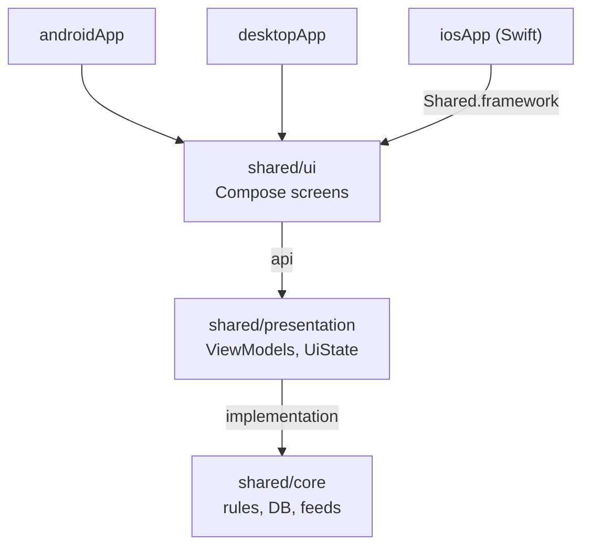

# Architecture

Damask is a Kotlin Multiplatform app. All logic is shared; each platform app supplies only its shell (and, later, audio playback).

## Modules

| Module | Contains | May not depend on |
|---|---|---|
| `shared/core` | Domain model, rotation rules, SQLDelight database, feed fetching and parsing, import | Compose, AndroidX lifecycle, any UI toolkit, the layers above |
| `shared/presentation` | ViewModels (AndroidX KMP `ViewModel`), `UiState`, intents, navigation state | **Compose**, Android, UIKit, `shared/ui` |
| `shared/ui` | Compose Multiplatform screens, theme and design tokens | `shared/core` directly |
| `androidApp`, `desktopApp` | Entry points only | `shared/core` |
| `iosApp` | Swift entry point hosting Compose | |
| `detekt-rules` | Project lint rules (see [guardrails](guardrails.md)) | |
| `architecture-tests` | Konsist tests for the layering | |
There's no server: search calls Apple's directory from the device ([spec › Search](spec.md#search)). The search backend that was built and dropped is on the `backend` branch.

Packages follow the modules: `uk.co.kilfeder.damask.podcasts.core`, `.presentation`, `.ui`.

## Why presentation has no Compose

The spec's thin UI rule says every screen's state and logic lives in a shared ViewModel, and composables only render state and forward intents. That lets iOS replace any Compose screen with SwiftUI later.

The module graph enforces it. `presentation` has no Compose dependency, so a ViewModel *can't* use `@Composable`, `mutableStateOf`, `Color` or `stringResource`: it won't compile. A SwiftUI screen consumes `presentation` exactly as a Compose screen does. And because `presentation` depends on `core` with `implementation`, not `api`, `ui` can't see `core` types either.

Rules that keep it that way:

- ViewModels are only obtained in the top-level screen composable and never passed down (compose-rules).
- ViewModels expose state only as `StateFlow`; `UiState` types are immutable data classes (Konsist).
- `ui` does no date or number formatting: values arrive preformatted in `UiState` (Konsist).
- User-visible strings come from resources (detekt).

## Presentation and UI

- **`AppGraph`** (`presentation/app`) is the object graph: one per process, created by each platform's entry point (`AppGraph.create(context)` on Android in `DamaskApplication`, `AppGraph.create()` on desktop and iOS). It owns the database, stores, importer and refresher, and has a factory for every ViewModel; the UI never constructs one itself.
- **One database thread.** Every read and write runs on `dbDispatcher` (`Dispatchers.IO.limitedParallelism(1)`), because the stores and the HLC clock aren't thread-safe.
- **Reactive snapshot.** `AppGraph.library` re-loads the `Library` whenever SQLDelight reports a change to a table it reads, and `rotation` derives a `Rotation` from it. ViewModels build their `UiState` from `rotation` alone (it carries the snapshot it orders, `rotation.library`), so a screen never mixes two snapshots, and updates after any write with no manual refresh.
- **Navigation** is shared state (`NavState`: the selected tab plus screens pushed on top), owned by `AppViewModel`; every launch opens on Home. Compose renders it in `App.kt`; system back pops it.
- **Window sizes** (`ui/WidthClass.kt`, `ui/Panes.kt`, `ui/Chrome.kt`). The shell measures its width and picks a band. Compact (under 600dp) has bottom tabs and an app bar. Medium (600–839dp) has a navigation rail, with Settings at its foot, and one pane. Expanded (840dp and up: unfolded foldables, landscape tablets, desktop) follows the TabletHome and TabletGenres artboards. It has no app bar: a 440dp list pane with its own heading, beside a rounded, tinted detail card. Home and Played sit beside the playing episode (or its show notes); Genres sits beside the selected genre's queue, which is highlighted in the list, with the mini-player at the foot of the card. Screens that aren't part of a pair (Settings, Import, an episode opened from the mini-player) are single panes with the app bar. On Home and Played, an episode you open shows in the right-hand pane (back returns it to whatever's playing); from Genres and Shows it opens full width. Opening another genre, show or episode replaces the one showing rather than stacking. The mini-player hides whenever the playing episode is on screen. The episode screen shows its notes beside the player once it's at least 720dp wide.
- **Formatting** happens in presentation (`format/Formats`): every summarised value is a `Summarised(summary, exact)`, and the UI shows the exact value on long press, hover or focus, and as the accessible label (`ExactValueText`).
- **Screens** each obtain their ViewModel once (`viewModel { graph.xViewModel() }`) and pass plain state and callbacks to stateless content, as compose-rules require.
- **The one Android exception:** presentation's `androidMain` bootstrap may import `android.content.Context` (to open the database). Konsist allows that file and nothing else.

## iOS

For v1 the iOS app hosts Compose. `shared/ui` builds the `Shared` framework and exports `presentation`. Xcode calls `./gradlew :shared:ui:embedAndSignAppleFrameworkForXcode`. When the SwiftUI layer arrives, it gets its own framework that exports `presentation` and never `ui`.

## Threading

`DeviceClock`, `UserStateStore` and `FeedStore` aren't thread-safe. All database writes are meant to run on one database dispatcher. This gets wired up with the first ViewModels.
