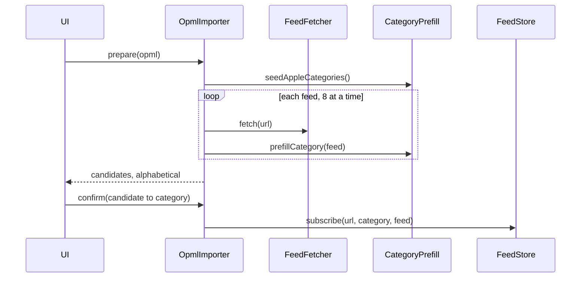

# Feeds

Feeds are fetched on the device; the server never touches them. Our search gateway is for discovery only: import never sends feed URLs to it. Code is in `core/feed`, `core/importer` and `core/data/FeedStore`.

## Import (first run)



- `Opml.parse` reads every `<outline xmlUrl=…>` at any depth and drops duplicates by normalised URL. A missing title becomes `""`, never the URL.
- Nothing is written before `confirm`. Feeds that failed to fetch can still be confirmed; the next refresh retries them.
- **Prefill:** the feed's first `itunes:category` is normalised (case, `&` vs `and`, and pre-2019 names like *Games & Hobbies* become *Leisure*; see `AppleCategories`). It's then looked up in `apple_category_map`, where an exact subcategory row beats the category's `''` row. Uncategorised if nothing maps.

## Show IDs

`ShowIds.fromFeedUrl` is the UUIDv5 (URL namespace) of the *normalised* feed URL (see [decisions](decisions.md)). `FeedUrl.normalise` lowercases the scheme and host, drops default ports, treats `http` as `https` and removes a trailing slash. It never touches the query string, because private feed tokens live there.

## Fetching: `FeedFetcher`

- Sends `If-None-Match` / `If-Modified-Since` from `feed_fetch_state`, so an unchanged feed costs a 304.
- Follows redirects itself (up to 5). If every hop was permanent (301/308), the result carries `movedPermanentlyTo`.
- Results: `Fetched`, `NotModified`, `Unavailable` (401/403), `Failed`. Failure reasons never contain the URL.
- `FeedFetcher.createClient()` is the app's Ktor client: OkHttp on Android and desktop, Darwin on iOS. Tests use Ktor's `MockEngine` (`MockFeeds` in commonTest).

## Parsing: `FeedParser`

RSS 2.0 plus iTunes tags, on xmlutil's `KtXmlReader` in relaxed mode (`feed/Xml.kt` builds a small tree):

- Character references (`&#8217;`) and XML's own entities are resolved by the reader. HTML entities that XML doesn't define (`&nbsp;`, `&mdash;`, …) come from a table; unknown ones are dropped.
- The iTunes namespace is matched leniently (odd capitalisation, or the `itunes:` prefix alone).
- Channel artwork comes from `itunes:image`, falling back to `<image><url>`. Categories are read with their nested subcategory.
- An item's GUID falls back to its enclosure URL. Items without an enclosure are skipped, and duplicate GUIDs are dropped.
- Dates are parsed leniently, as RFC 822 variants and ISO 8601 (`FeedDates`); `itunes:duration` accepts `H:M:S`, `M:S` or seconds.

## Refresh: `FeedRefresher`

`refresh(showId)` / `refreshAll()` (6 at a time):

| Fetch result | Effect |
|---|---|
| Fetched | Store channel data, categories and episodes; apply retention; save cache headers. A permanent redirect or `itunes:new-feed-url` moves the show to the new URL (same ID) and clears the old cache headers |
| Not modified | Record the time |
| Unavailable | Mark the feed `UNAVAILABLE`. Nothing is deleted; the UI will prompt to replace the URL |
| Failed / unparseable | Mark `FAILED` with a short reason |

## Testing against real feeds

`RealOpmlSmokeTest` (jvmTest) runs the real import over the network against any OPML file. It's skipped unless given a path, so `check` never touches the network:

```sh
./gradlew :shared:core:jvmTest --tests '*RealOpmlSmokeTest*' -Pdamask.opml=llm-scrapbook/podcasts_opml.xml
```

It writes `import-report.md` next to the OPML file: per show, the type, episode count, undated episodes, missing durations, feed category, prefill and any problem. The report contains no feed URLs. Keep real exports in `llm-scrapbook/`, which is gitignored, because they can contain private feed URLs.

Last run (27 Nov 2026, a 78-feed Pocket Casts export across 26 hosts): 76 imported in about 3 s, every date parsed, and every show prefilled to an Apple category. The two failures are feeds that return 404 upstream.

Not built yet: scheduling (WorkManager on Android), basic-auth feeds (credentials in Keystore/Keychain), and re-fetching a feed when a download's signed audio link has expired.
