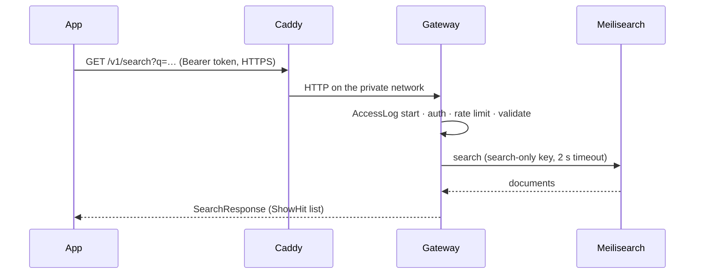

# Server: search

Search is for discovery only ([spec › Search](spec.md#search)). The app never talks to Podcast Index: it calls our gateway, which searches our own Meilisearch index, rebuilt weekly from Podcast Index's public catalogue dump. Deployment is in [deploy/README.md](../deploy/README.md); the checks are in [guardrails › Server](guardrails.md#server).

## Modules

| Module | Contains | Used by |
|---|---|---|
| `shared/api` | The `/v1` wire types (`SearchResponse`, `ShowHit`, `ApiError`, `HealthResponse`) and the path, parameter and limit constants. Kotlin Multiplatform; depends only on kotlinx-serialization | The app and `server/search` |
| `server/meili` | `MeiliClient` (read: search, health, stats, tasks), `MeiliAdmin` (write: indexes, settings, documents, swap, keys), `PodcastDocument` and the index settings. Server-only | `server/search`, `server/importer` |
| `server/search` | The Ktor gateway | Deployed as `damask-gateway` |
| `server/importer` | The weekly dump-to-index CLI | Deployed as `damask-importer` |

`server/*` may use `shared/api` and nothing else from `shared/` (Konsist), so the server can't come to depend on app code.

## A search request



1. **Auth** (`Auth.kt`, `Gateway.kt`). Either provider can succeed:
   - **Supabase:** an ES256 JWT verified locally against `$SUPABASE_URL/auth/v1/.well-known/jwks.json`, with `exp`, `iss` (`$SUPABASE_URL/auth/v1`) and `aud` (`authenticated`) checked (30 s leeway). Anonymous users are accepted. `JwksKeyProvider` caches the keys, refetches hourly or when a token names an unknown `kid`, and never more than once every 30 s.
   - **Private build:** `PRIVATE_TOKEN`, compared in constant time (both sides SHA-256 hashed, then `MessageDigest.isEqual`). Off when unset.
2. **Rate limit** (`TokenBucket.kt`). Keyed on the token's `sub`, or `private`: bursts of 20, refilling at 1 a second. Over the limit is a 429 with `Retry-After`. Ktor drops a user's bucket once it would be full again, so memory tracks active users only.
3. **Validation** (`SearchParams.kt`).
   - `q`: 1–100 characters after trimming.
   - `lang`: a language, or a language and region (`LANG_PATTERN`: 2–3 letters, optionally `-` and 2 letters or 3 digits, any case: `en`, `en-GB`, `es-419`). Normalised by `Languages.tag` to lowercase (`en-gb`). The app sends the device locale.
   - `category`: repeatable, each one of the 19 keys in `SearchCategories.KEYS` (`shared/api`, the one source of truth); duplicates are dropped.
   - `hideExplicit`: `true`/`false`. `limit`: 1–20. `offset`: 0–40.

   Anything else is a 400 whose message names the parameter, never its value.
4. **Search** (`SearchSource`). Routes only ever see the interface. `MeiliSource` builds the filter (see [Language, region and categories](#language-region-and-categories)), searches, and maps documents to `ShowHit`. With `PI_PASSTHROUGH=true` (private build only), `PodcastIndexSource` calls the Podcast Index API with server-held credentials and an honest `Damask/<version>` User-Agent instead.
5. **Errors** (`StatusPages`). Always `ApiError` JSON: 400 `bad_request`, 401 `unauthorized`, 404 `not_found`, 429 `rate_limited`, 503 `unavailable` (Meilisearch failed or timed out), 500 `internal`. Never a stack trace or exception text.
6. **Access log** (`AccessLog.kt`): `GET /v1/search 200 12ms caller=<12-hex hash of sub>`. No query string, no query text, no raw `sub`. Ktor's `CallLogging` isn't used (it logs the full URI), and Caddy's access log is off for the same reason.

## Language, region and categories

Filters, ANDed together:

| Param | Filter | Note |
|---|---|---|
| `lang` | `languagePrefix = "en" OR languagePrefix IS EMPTY OR languagePrefix NOT EXISTS` | Shows that don't declare a language (56,107 in the November 2026 dump) always pass. A user setting for extra languages may come later; it would add more prefixes to this OR |
| `category` | `topCategories IN ["news", "comedy"]` | ORed within. Shows with no categories are excluded only when a category is given. It filters; it doesn't boost |
| `hideExplicit=true` | `explicit = false` | |

**Region boost.** When `lang` has a region (`en-GB`), shows tagged with exactly that region are nudged up, ahead of other English and language-less shows, without overriding a much better match:

1. Two searches run in parallel with the same filters: one adds `languageTag = "en-gb"`, the other `NOT languageTag = "en-gb"`. Each fetches `offset + limit + 5` hits from position 0 (the 5 is slack for duplicates), with `showRankingScoreDetails`.
2. `RegionMerge` does a two-way merge of the two already-ranked lists. It compares two hits rule by rule, in ranking-rule order: the score of `words`, `typo` and `proximity`, then `rankScore` (the regional side's multiplied by `REGION_BOOST`, default 1.25), then the score of `attribute` and `exactness`. The first rule whose values differ by more than 1e-9 decides; on a full tie the regional hit goes first.
3. A show in both lists (the same `dedupeKey` under two feeds) keeps its first, better-ranked copy. Then the gateway drops `offset` hits and takes `limit`.

Meilisearch's own federated search can't do this: its `_rankingScore` ignores custom rules such as `rankScore:desc`, so a merge by that score put a weak `en-gb` show above a strong `en-us` one. Raise `REGION_BOOST` to favour the user's region more; 1 turns the boost off and leaves only the two-way split.

## Ranking

Rules, in order: `words`, `typo`, `proximity`, `rankScore:desc`, `attribute`, `sort`, `exactness`.

The first three decide how well the text matches (every word, few typos, the words close together). Among equally good matches, `rankScore` ranks popular, active shows first. Only then do `attribute` (title before author) and `exactness` count. Putting `rankScore` before `proximity` was measured and is worse: "hardcore history" returned "The History of Punk Rock Podcast" first, and "the rest is history" pulled in "…And The Rest Is Film History".

`rankScore` is computed at import (`RankScore.kt`) from four of the dump's columns: `popularityScore`, `newestItemPubdate`, `itunesId` and `oldestItemPubdate`:

```
age_days   = max(0, (import time - newestItemPubdate) / 86400)         no date: freshness 0
freshness  = 0.5 ^ (age_days / RANK_HALF_LIFE_DAYS)
feed_years = max(0, (import time - oldestItemPubdate) / (365 * 86400))  no date: 0
rankScore  = (min(popularity, 9) + RANK_POPULARITY_PRIOR)
           * (RANK_FRESHNESS_FLOOR + (1 - RANK_FRESHNESS_FLOOR) * freshness)
           * (RANK_APPLE_LISTED_BOOST if itunesId is set, else 1)
           * (1 + RANK_FEED_AGE_BOOST * min(1, feed_years / RANK_FEED_AGE_FULL_YEARS))
```

then rounded down to a multiple of `RANK_STEP` when that's set. It changes smoothly; there are no buckets or cliffs. `popularityScore` runs 0–9 in the dump. One row of 4.77 million has 29, so it's clamped to 9.

- **Apple-listed.** A show whose dump row has an Apple Podcasts ID (`itunesId`, non-empty and non-zero) is multiplied by 1.5. Re-uploads and spam feeds are rarely in Apple's directory; 72% of kept shows are, and 85% of those with popularity 5 or more. The data comes only from the dump: Damask never calls Apple. It's a boost, not a filter, so unlisted shows stay findable by name.
- **Feed age.** A feed gains up to 10%, rising evenly to full effect at 5 years since its oldest episode. It's measured from `oldestItemPubdate`, not `episodeCount`, which would reward bulk re-uploads.

Why 1.5. At equal freshness, a listed show scores `(p + 1) × 1.5` against an unlisted show's `(q + 1)`:

| Listed popularity | Score | Beats unlisted popularity 9 (score 10)? |
|---|---|---|
| 9 | 15 | Yes |
| 7 | 12 | Yes: two points of popularity are outweighed |
| 6 | 10.5 | Yes, just |
| 5 | 9 | No |
| 2 | 4.5 | No: a weak listed show doesn't beat a strong unlisted one |

Recency still counts: a listed show silent for 5 years (`0.42 × 10 × 1.5 ≈ 6.3`) loses to an active unlisted one (10). And `rankScore` comes after `words`, `typo` and `proximity`, so no boost lifts a worse text match. `RankScoreTest` pins these cases, including the real "hardcore history" one in [decisions](decisions.md#server).

| Knob | Default | Does | Turn it… |
|---|---|---|---|
| `RANK_HALF_LIFE_DAYS` | 365 | Days for a show's recency weight to halve | Down: recency matters more and sooner. Up: popularity dominates |
| `RANK_FRESHNESS_FLOOR` | 0.4 | Share of its weight a show keeps however old it is | Up: finished series (Serial season 1) hold their place. Down: dormant shows sink |
| `RANK_POPULARITY_PRIOR` | 1 | Added to popularity, so popularity 0 still has some recency | Up: popularity matters less relative to recency |
| `RANK_APPLE_LISTED_BOOST` | 1.5 | Multiplies `rankScore` for shows with an Apple Podcasts ID in the dump | Up: listed shows win against more popular unlisted ones. 1: off |
| `RANK_FEED_AGE_BOOST` | 0.1 | The most a long-running feed gains (0.1 = 10%) | Up: established feeds win more. 0: off |
| `RANK_FEED_AGE_FULL_YEARS` | 5 | Years since the oldest episode at which the feed-age gain is complete | Down: young feeds reach it sooner |
| `RANK_STEP` | 0 (off) | Rounds `rankScore` down to a multiple of this, so near-equal scores tie and the title rules decide | Leave it at 0. It turns the smooth score into bands with cliffs (8.9 vs 9.0 becomes a 0.5 gap; 9.0 vs 9.4 a tie). See [decisions › Server](decisions.md#server) before changing it |
| `REGION_BOOST` (gateway) | 1.25 | Multiplies `rankScore` for shows in the user's exact region, at merge time | Up: the user's region wins more often. 1: off |

**Tuning without a re-import.** `importer rescore` recomputes `rankScore` in place with Meilisearch's experimental edit-documents-by-function (a Rhai version of the same formula; `RescorerTest` keeps the two in step). It needs no download, but it is not faster: on the full index (2.8 M documents) it took 17 minutes on an M-series Mac, against 7 for a whole re-import, because Meilisearch re-indexes every edited document. Use it when the dump can't be fetched; otherwise a re-import with the new values (`-e RANK_HALF_LIFE_DAYS=180 importer`) is quicker:

```sh
cd deploy
docker compose --env-file local.env -f docker-compose.yml -f docker-compose.local.yml --profile import \
  run --rm -e RANK_HALF_LIFE_DAYS=180 importer rescore
```

It reuses each document's `scoredAt` (the import time), so rescoring doesn't age the index. Set the knobs in `.env` too, or the next weekly import puts back the old values. `REGION_BOOST` is read by the gateway, so changing it needs only a gateway restart.

## Health

`GET /health`, no auth, for an external uptime monitor:

| Field | Meaning |
|---|---|
| `db` | Meilisearch answers a (zero-result) search on `podcasts`, so it's up and the index exists. A search rather than an index lookup, because the gateway's key may only search |
| `cert` | The public certificate, checked by a TLS handshake to `PUBLIC_HOSTNAME`: `ok` (more than 14 days left), `warning` (14 or fewer), `expired` (expired or unreadable), `unknown` (no hostname, e.g. local). Cached for an hour |
| `status` | `down` if not `db` (HTTP 503), `warning` if `cert` is `warning` or `expired` (HTTP 200), else `ok` |

## The weekly import

`importer import` (`Main.kt`), run by a systemd timer on Sundays at 03:30 UTC:

1. Make sure the gateway's search-only key exists, with the fixed `MEILI_SEARCH_KEY_UID`.
2. Download `https://public.podcastindex.org/podcastindex_feeds.db.tgz` (about 1.8 GB). Podcast Index refuses generic User-Agents, so it sends `Damask/<version> (search index importer)`. Then unpack it: a small built-in tar reader takes the `.db`, skipping macOS `._` metadata files. `DUMP_FILE` uses a local `.tgz`, `.db` or `.sql` (the fixture) instead.
3. `DumpReader` streams the kept rows:
   - live (`dead = 0`);
   - not a duplicate (`duplicateOf` is `''` in the real dump, or NULL or 0);
   - at least one episode;
   - last fetch answered 2xx;
   - not junk: popularity 0 together with fewer than 3 episodes, or nothing newer than 3 years.
4. `IndexBuilder` builds `podcasts_<yyyyMMdd>`:
   - apply the settings;
   - upload NDJSON batches of 10,000 as rows stream in, then wait for every task;
   - check that the document count equals the kept count;
   - swap the new index with `podcasts` and delete the old data.

   Any failure deletes the half-built index and leaves `podcasts` untouched, and the process exits 1.

### Index documents and settings

`PodcastDocument` fields:

| Field | From the dump |
|---|---|
| `id` | `id` |
| `title` | `title` |
| `author` | `itunesAuthor` |
| `ownerName` | `itunesOwnerName` |
| `imageUrl` | `imageUrl`; empty becomes null |
| `feedUrl` | `url` |
| `podcastGuid` | `podcastGuid`; empty becomes null |
| `language` | `language`, kept as written |
| `languageTag` | Derived by `Languages.tag`: lowercase, `_` becomes `-`, common aliases folded (`eng`, `english`, `EN` → `en`; `en_US` → `en-us`). Empty when the dump has none |
| `languagePrefix` | Derived: the part of `languageTag` before `-` |
| `explicit` | `explicit` |
| `itunesType` | `itunesType` |
| `episodeCount` | `episodeCount` |
| `newestItemPubdate` | `newestItemPubdate`, epoch seconds |
| `oldestItemPubdate` | `oldestItemPubdate`, epoch seconds; 0 or missing becomes null |
| `popularityScore` | `popularityScore` (0–9) |
| `appleListed` | `itunesId` is non-empty and non-zero (the dump writes "none" as `''`) |
| `rankScore` | Derived; see [Ranking](#ranking) |
| `scoredAt` | The import time `rankScore` was computed for |
| `categories` | `category1..10`, non-empty, de-duplicated, in order |
| `topCategories` | Derived by `TopCategories`: each category mapped to one of Apple's 19 top-level keys (subcategories to their parent, legacy names as in the app's `AppleCategories`), de-duplicated. The table lists every word in the dump. 123,462 shows (4.4%) have none, all because they have no categories at all |
| `dedupeKey` | `podcastGuid`, else `chash`, else `id:<id>` |

Settings (`PodcastIndex.settings`):

- **Searchable:** `title`, `author`, `ownerName`.
- **Filterable:** `languagePrefix`, `languageTag`, `explicit`, `categories`, `topCategories`.
- **Ranking rules:** see [Ranking](#ranking).
- **`distinctAttribute`:** `dedupeKey`.
- **`maxTotalHits`:** 100.

## Configuration

All environment variables; see [deploy/.env.example](../deploy/.env.example).

| Variable | Used by | Meaning |
|---|---|---|
| `MEILI_URL` | both | Meilisearch base URL (compose: `http://meilisearch:7700`) |
| `MEILI_MASTER_KEY` | importer | Full access; never given to the gateway |
| `MEILI_SEARCH_KEY_UID` | importer | UID of the gateway's search-only key |
| `MEILI_SEARCH_KEY` | gateway | That key's value, `HMAC-SHA256(master, uid)` (`deploy/search-key.sh`) |
| `SUPABASE_URL` | gateway | Enables Supabase JWT auth |
| `PRIVATE_TOKEN` | gateway | Enables the private-build token |
| `PUBLIC_HOSTNAME` | gateway | Enables the certificate check |
| `PI_PASSTHROUGH`, `PI_KEY`, `PI_SECRET` | gateway | Private-build passthrough to the Podcast Index API |
| `DUMP_URL`, `DUMP_FILE`, `WORK_DIR`, `BATCH_SIZE` | importer | Dump source and import tuning |
| `ONLY_IF_EMPTY` | importer | `true`: skip the import if `podcasts` already has documents (the local seed uses it so it never overwrites a real import) |
| `RANK_HALF_LIFE_DAYS`, `RANK_FRESHNESS_FLOOR`, `RANK_POPULARITY_PRIOR`, `RANK_APPLE_LISTED_BOOST`, `RANK_FEED_AGE_BOOST`, `RANK_FEED_AGE_FULL_YEARS`, `RANK_STEP` | importer | `rankScore`; see [Ranking](#ranking) |
| `REGION_BOOST` | gateway | See [Ranking](#ranking) |
| `DAMASK_VERSION` | both | Goes in User-Agents |

## Running and testing

- `./gradlew :shared:api:jvmTest :server:meili:check :server:search:check :server:importer:check :architecture-tests:test` runs everything. The Meilisearch tests start a real Meilisearch in Docker (Testcontainers) and are skipped, not failed, without Docker.
- `deploy/build.sh`, then `docker compose --env-file local.env -f docker-compose.yml -f docker-compose.local.yml up` in `deploy/`, runs the whole stack locally on `localhost:8080` against the fixture index (`deploy/fixtures/podcasts.sql`: 12 rows, one per filter rule, 6 kept).
