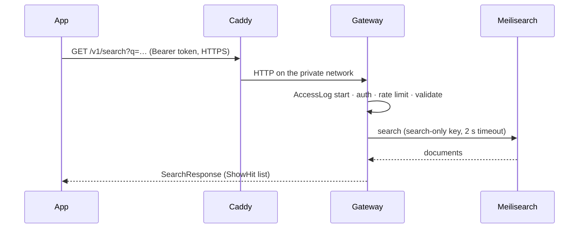

# Server: search

Search is for discovery only ([spec › Search](spec.md#search)). The app never talks to Podcast Index: it calls our gateway, which searches our own Meilisearch index, rebuilt weekly from Podcast Index's public catalogue dump. Deployment is in [deploy/README.md](../deploy/README.md); the checks are in [guardrails › Server](guardrails.md#server).

## Modules

| Module | Contains | Used by |
|---|---|---|
| `shared/api` | The `/v1` wire types (`SearchResponse`, `ShowHit`, `ApiError`, `HealthResponse`) and the path, parameter and limit constants. Kotlin Multiplatform; depends only on kotlinx-serialization | The app and `server/search` |
| `server/meili` | `MeiliClient` (read: search, health, stats, tasks), `MeiliAdmin` (write: indexes, settings, documents, swap, keys), `PodcastDocument` and the index settings. Server-only | `server/search`, `server/importer` |
| `server/search` | The Ktor gateway | Deployed as `damask-gateway` |
| `server/importer` | The weekly dump-to-index CLI | Deployed as `damask-importer` |

`server/*` may use `shared/api` and nothing else from `shared/` (Konsist), so the server can't come to depend on app code.

## A search request

1. **Auth** (`Auth.kt`, `Gateway.kt`). Either provider can succeed:
   - **Supabase:** an ES256 JWT verified locally against `$SUPABASE_URL/auth/v1/.well-known/jwks.json`, with `exp`, `iss` (`$SUPABASE_URL/auth/v1`) and `aud` (`authenticated`) checked (30 s leeway). Anonymous users are accepted. `JwksKeyProvider` caches the keys, refetches hourly or when a token names an unknown `kid`, and never more than once every 30 s.
   - **Private build:** `PRIVATE_TOKEN`, compared in constant time (both sides SHA-256 hashed, then `MessageDigest.isEqual`). Off when unset.
2. **Rate limit** (`TokenBucket.kt`). Keyed on the token's `sub`, or `private`: bursts of 20, refilling at 1 a second. Over the limit is a 429 with `Retry-After`. Ktor drops a user's bucket once it would be full again, so memory tracks active users only.
3. **Validation** (`SearchParams.kt`). `q` 1–100 characters after trimming; `lang` 2–3 letters; `hideExplicit` `true`/`false`; `limit` 1–20; `offset` 0–40. Anything else is a 400 whose message names the parameter, never its value.
4. **Search** (`SearchSource`). `MeiliSource` maps `lang` to `languagePrefix = "xx"` and `hideExplicit` to `explicit = false`. Routes only ever see the interface. With `PI_PASSTHROUGH=true` (private build only), `PodcastIndexSource` calls the Podcast Index API with server-held credentials and an honest `Damask/<version>` User-Agent instead.
5. **Errors** (`StatusPages`). Always `ApiError` JSON: 400 `bad_request`, 401 `unauthorized`, 404 `not_found`, 429 `rate_limited`, 503 `unavailable` (Meilisearch failed or timed out), 500 `internal`. Never a stack trace or exception text.
6. **Access log** (`AccessLog.kt`): `GET /v1/search 200 12ms caller=<12-hex hash of sub>`. No query string, no query text, no raw `sub`. Ktor's `CallLogging` isn't used (it logs the full URI), and Caddy's access log is off for the same reason.

## Health

`GET /health`, no auth, for an external uptime monitor:

| Field | Meaning |
|---|---|
| `db` | Meilisearch answers a (zero-result) search on `podcasts`, so it's up and the index exists. A search rather than an index lookup, because the gateway's key may only search |
| `cert` | The public certificate, checked by a TLS handshake to `PUBLIC_HOSTNAME`: `ok` (more than 14 days left), `warning` (14 or fewer), `expired` (expired or unreadable), `unknown` (no hostname, e.g. local). Cached for an hour |
| `status` | `down` if not `db` (HTTP 503), `warning` if `cert` is `warning` or `expired` (HTTP 200), else `ok` |

## The weekly import

`importer import` (`Main.kt`), run by a systemd timer on Sundays at 03:30 UTC:

1. Make sure the gateway's search-only key exists, with the fixed `MEILI_SEARCH_KEY_UID`.
2. Download `https://public.podcastindex.org/podcastindex_feeds.db.tgz` (about 1.8 GB). Podcast Index refuses generic User-Agents, so it sends `Damask/<version> (search index importer)`. Then unpack it: a small built-in tar reader takes the `.db`, skipping macOS `._` metadata files. `DUMP_FILE` uses a local `.tgz`, `.db` or `.sql` (the fixture) instead.
3. `DumpReader` streams the kept rows:
   - live (`dead = 0`);
   - not a duplicate (`duplicateOf` is `''` in the real dump, or NULL or 0);
   - at least one episode;
   - last fetch answered 2xx;
   - not junk: popularity 0 together with fewer than 3 episodes, or nothing newer than 3 years.
4. `IndexBuilder` builds `podcasts_<yyyyMMdd>`:
   - apply the settings;
   - upload NDJSON batches of 10,000 as rows stream in, then wait for every task;
   - check that the document count equals the kept count;
   - swap the new index with `podcasts` and delete the old data.

   Any failure deletes the half-built index and leaves `podcasts` untouched, and the process exits 1.

### Index documents and settings

`PodcastDocument` fields:

| Field | From the dump |
|---|---|
| `id` | `id` |
| `title` | `title` |
| `author` | `itunesAuthor` |
| `ownerName` | `itunesOwnerName` |
| `imageUrl` | `imageUrl`; empty becomes null |
| `feedUrl` | `url` |
| `podcastGuid` | `podcastGuid`; empty becomes null |
| `language` | `language`, kept as written |
| `languagePrefix` | Derived: `en-GB` becomes `en` |
| `explicit` | `explicit` |
| `itunesType` | `itunesType` |
| `episodeCount` | `episodeCount` |
| `newestItemPubdate` | `newestItemPubdate`, epoch seconds |
| `popularityScore` | `popularityScore` |
| `categories` | `category1..10`, non-empty, de-duplicated, in order |
| `dedupeKey` | `podcastGuid`, else `chash`, else `id:<id>` |

Settings (`PodcastIndex.settings`):

- **Searchable:** `title`, `author`, `ownerName`.
- **Filterable:** `languagePrefix`, `explicit`, `categories`.
- **Ranking rules:** `words`, `typo`, `proximity`, `attribute`, `sort`, `exactness`, then `popularityScore:desc` and `newestItemPubdate:desc`.
- **`distinctAttribute`:** `dedupeKey`.
- **`maxTotalHits`:** 100.

## Configuration

All environment variables; see [deploy/.env.example](../deploy/.env.example).

| Variable | Used by | Meaning |
|---|---|---|
| `MEILI_URL` | both | Meilisearch base URL (compose: `http://meilisearch:7700`) |
| `MEILI_MASTER_KEY` | importer | Full access; never given to the gateway |
| `MEILI_SEARCH_KEY_UID` | importer | UID of the gateway's search-only key |
| `MEILI_SEARCH_KEY` | gateway | That key's value, `HMAC-SHA256(master, uid)` (`deploy/search-key.sh`) |
| `SUPABASE_URL` | gateway | Enables Supabase JWT auth |
| `PRIVATE_TOKEN` | gateway | Enables the private-build token |
| `PUBLIC_HOSTNAME` | gateway | Enables the certificate check |
| `PI_PASSTHROUGH`, `PI_KEY`, `PI_SECRET` | gateway | Private-build passthrough to the Podcast Index API |
| `DUMP_URL`, `DUMP_FILE`, `WORK_DIR`, `BATCH_SIZE` | importer | Dump source and import tuning |
| `DAMASK_VERSION` | both | Goes in User-Agents |

## Running and testing

- `./gradlew :shared:api:jvmTest :server:meili:check :server:search:check :server:importer:check :architecture-tests:test` runs everything. The Meilisearch tests start a real Meilisearch in Docker (Testcontainers) and are skipped, not failed, without Docker.
- `deploy/build.sh`, then `docker compose --env-file local.env -f docker-compose.yml -f docker-compose.local.yml up` in `deploy/`, runs the whole stack locally on `localhost:8080` against the fixture index (`deploy/fixtures/podcasts.sql`: 12 rows, one per filter rule, 6 kept).
